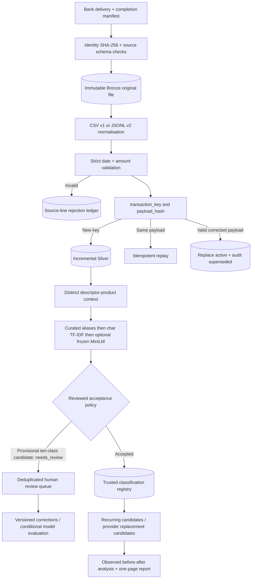

# Release 2 system map and decisions

- **Bronze identity:** source byte digest + source-line creates immutable source-occurrence evidence. Originals remain untouched.
- **Silver transaction identity:** `sha256(JSON(["transaction_key_v1", bank_id, transaction_id]))`. Assumes IDs stable and bank-scoped; obtain bank/account namespace confirmation before actual use.
- **Canonical payload identity:** hash of customer ID, strictly parsed date, signed decimal, currency, canonical description. A valid changed payload with the same key triggers latest-valid-observed-delivery replacement and an immutable supersession record. No authoritative source version/DELETE event is supplied; the precedence assumption may select a stale correction if deliveries are out of order.
- **Date contract:** CSV `%Y-%m-%d`; JSONL `%d/%m/%Y`, plus explicit ISO variation permitted for October. `source_period`, `booking_date`, and ingestion time are different.
- **Reference-data governance:** original `data/merchant_labels.csv` stays unchanged. Curated `classification/curated_aliases.csv` corrects Octopus and Tesco Mobile, but these are developer-reviewed **demo** decisions; a bank needs approval evidence and product context. Generic multi-product companies remain unresolved.
- **Machine learning:** string n-gram TF-IDF retrieves candidate matches. MiniLM-L6-v2 is a pretrained offline semantic retriever if provisioned. Neither similarity score provides calibrated confidence; unverified candidates receive a ten-class provisional prediction with `needs_review=true` and cannot enter trusted features.
- **Business features:** Recurring and switch outputs are candidate heuristics only. Switch candidates are cross-checked independently against active Silver, with additional transaction-ID provenance, month-based evidence tiers and an explicit unconfirmed/savings-unverified summary (`docs/SWITCH_EVIDENCE_VALIDATION.md`). Review-required predictions are excluded from trusted analytics. Merchant changes do not prove termination, and observed price changes are not causal savings.
- **MLOps:** keep versioned catalogue, model/adapter taxonomy versions, review-required/new-descriptor rates, reviewed accepted-sample precision and error feedback. Retrain only if a representative ground-truth corpus and held-out improvement justify it. No automatic retraining.

## Scored taxonomy compliance

The employer confirmed **exactly ten scored categories**. Release 2 exports a provisional category from those ten for each input with `needs_review=true` when product evidence is insufficient. `REVIEW_REQUIRED` is a separate internal status, never a category. Such provisional candidates are excluded from trusted bill and switch evidence.
