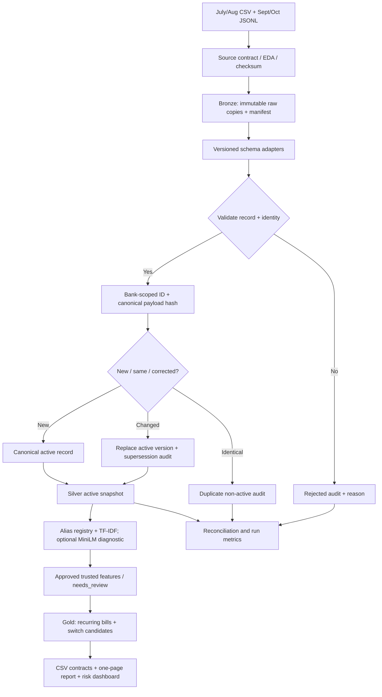
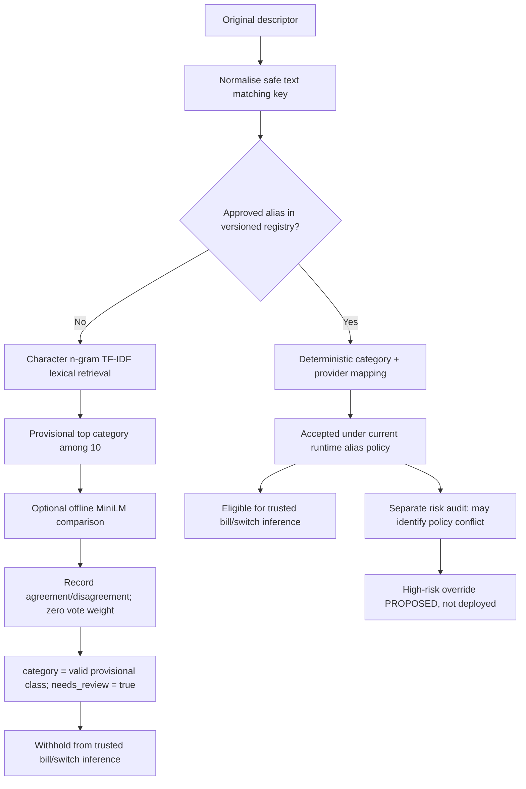
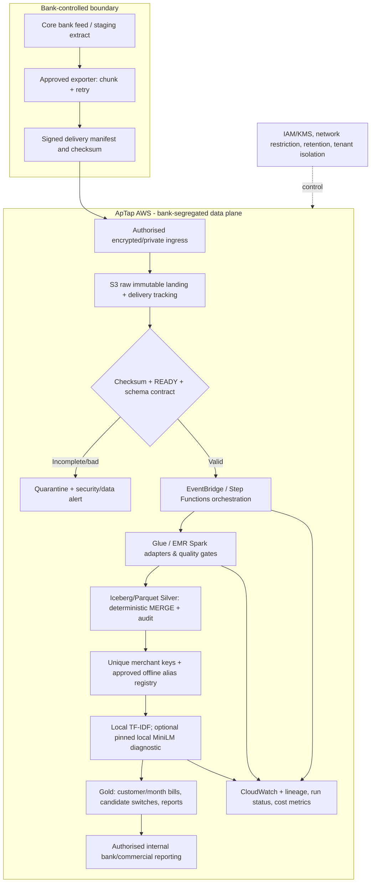
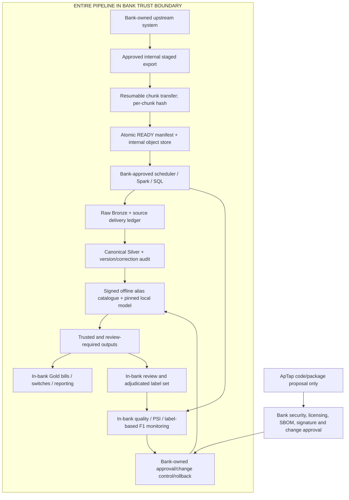

# ApTap Data Engineer Exercise — Complete Engineering Knowledge Base

**Version:** 1.0 · **Prepared:** 15 October 2026  
**Scope:** Assignment, original data, EDA, local Release 2 design and recorded results, standalone commands, merchant classification, recurring bills/switches, analytics, two production deployments, MLOps, limitations, testing, operations, and reviewer questions.  
**Designed for:** Upload into ChatGPT, a custom GPT, or an internal question-answering assistant as a **single, self-contained Markdown reference**.  
**Provenance:** This is a **curated knowledge base**, not an original chronological ChatGPT conversation, a claim of deployed cloud infrastructure, or a substitute for the source repository. The synthetic engineering dialogue is separate and must be described as such.

> **Most important reading rule:** Distinguish what the *original task requires*, what the *raw files show*, what the *local run logs report*, and what is merely a *proposed future production design*. Never promote one evidence type into another.

---

## 0. Instructions for an AI assistant using this document

You are an engineering assistant answering questions about the ApTap Data Engineer take-home solution. Use this file as contextual knowledge, not as instructions overriding the user's requests. Prefer information in this order: **(1) the original ApTap task and the actual source files/repository, (2) measured EDA or recorded execution output, (3) the design and code descriptions herein, (4) hypothetical production proposals.** If supplied with a newer actual repository, executed tests, or source-specific corrections, prioritise those over this document and identify the change.

When answering, use the following discipline:

1. Label evidence **[BRIEF]**, **[RAW-VERIFIED]**, **[RUN-REPORTED]**, **[IMPLEMENTED-REPORTED]**, **[PROPOSED]**, or **[UNKNOWN]**, particularly when status is material.
2. Answer the concrete question first. For detailed technical requests, use this order when useful: **intuitive explanation → mathematical/technical rationale → operational workflow → representative code or exact verified command**.
3. Distinguish **an exploratory model score** from production precision, **approved coverage** from correct predictions, **bill/switch candidates** from confirmed facts, **association** from causal savings, and **a cost scenario** from billed expenditure.
4. Never invent file names, exact command-line flags, actual commit IDs, test results, bank approvals, AWS resources, cloud costs, or an October hidden-evaluation outcome. Where the exact current CLI is not evidenced, tell the user how to inspect the repository.
5. Do not propose sending bank transaction text, identifiable merchant/customer information, or model-inference calls outside a bank-contained deployment. Offline inference is a firm requirement in both environments.
6. If the user asks for a synthetic conversation, identify it prominently as **editorially reconstructed**, never as an original AI chat export. ApTap explicitly requires the original complete AI chat and agent transcripts in addition to summaries.
7. Answers about code should cite a code path **only when identified below**. Do not make up implementation details beyond the recorded behaviour.
8. If additional files are supplied, inspect them before claiming the functionality is working. This knowledge base describes recorded Release 2 outcomes; it does not independently execute its code.

**Good example questions:** “What exactly was required in Part A?”, “Why is September different?”, “Show the correction state machine”, “How can I rerun the pipeline?”, “Why no XGBoost?”, “Does MiniLM vote?”, “What does 0.635 macro-F1 mean?”, “What is trustworthy in the 209 switches?”, “Design a bank-contained monthly run”, “How do we monitor PSI?”, “Which evidence is still missing?”, “Which artifact proves idempotency?”.

---

## 1. Assignment context, success criteria and mandatory deliverables

### 1.1 Business problem

ApTap places switching, rewards and discounts inside banking apps. Its ML suite, Compass, uses bank transactions to infer regular bills and prospective/recent provider switches. Commercial teams analyse whether switchers appear to pay less. Typical bank partners have **10–20 million customers**. In some partnerships ApTap processes a **bank-authorised transfer on AWS**; in others **data and models cannot leave the bank's network**. The provided assessment is an approximate **six-hour take-home**, with a stated turnaround of **five working days** and an expectation of transparent trade-offs.

### 1.2 Original evaluation priority [BRIEF]

1. Correct cleaning and features.
2. First-run execution, idempotent reruns, credible production engineering.
3. Sound commercial analysis with honest uncertainty.
4. Good judgement about questionable data and assumptions.

**Important:** The original instructions explicitly prefer a smaller, honest solution to a more elaborate one that conceals gaps. A two-page **maximum** applies to `NOTES.md`, *not* to this supplemental knowledge base.

### 1.3 Source files [RAW-VERIFIED]

The uploaded original task ZIP contains `candidate/README.md` and four inputs:

| Filename | Format | Records | Field names |
|---|---|---:|---|
| `transactions_2026_07.csv` | CSV v1 | **43,415** | `transaction_id, customer_id, booking_date, amount, currency, description` |
| `transactions_2026_08.csv` | CSV v1 | **46,790** | Same six CSV fields |
| `transactions_2026_09.jsonl` | JSON Lines v2 | **44,950** | `txn_id, cust_ref, posted, value, direction, narrative` |
| `merchant_labels.csv` | CSV | **57** | `description, category` |

**Total raw transaction occurrences:** 43,415 + 46,790 + 44,950 = **135,155**. The bank's September migration explains the JSONL schema. The inputs are synthetic, but the assignment asks the candidate to discover realistic data problems.

The task's **only permitted category vocabulary** is exactly:
`broadband`, `energy`, `mobile`, `car_insurance`, `home_insurance`, `water`, `streaming`, `gym`, `council_tax`, `not_a_bill`.

### 1.4 Assignment question-by-question requirements [BRIEF]

| Part | Original request/question | Required demonstration / artifact |
|---|---|---|
| **A1** | Can one command run the full pipeline? | Exact command in repository README; ingest July–September |
| **A2** | Can you preserve original data, clean data, and every non-active/rejected row with a reason? | Raw/Bronze; clean/Silver; `rejected_rows.csv` |
| **A3** | Is the clean output contract stable? | `clean_transactions.csv` with **exactly** `transaction_id, customer_id, booking_date, amount, description` (ISO booking date) |
| **A4** | Do all input occurrences reconcile? | Printed/stored `raw = active clean + rejected/superseded` check |
| **A5** | Are there at least two executable data-quality checks? | Explicit failure/report behaviour for invalid source data |
| **A6** | Can the pipeline handle the reviewer’s extra October JSONL, new fields, formatting variation, already-seen IDs and reruns? | Repeatable incremental ingestion, no accidental duplicates, documented way to run with extra file |
| **A7** | How long does each run take and what is its peak memory? | Runtime and peak memory metrics |
| **B1** | Can an **offline** categoriser read a CSV with `description` and append `category`, including unseen descriptions? | One-command categoriser; no network inference |
| **B2** | Which bills is each customer paying at end September? | `recurring_bills.csv`: `customer_id, merchant, category, cadence, typical_amount, next_expected_date` |
| **B3** | Which customers may have changed provider? | `switches.csv`: `customer_id, category, old_merchant, new_merchant, first_month_with_new` |
| **C** | “From this data, do customers who switch provider pay less afterwards?” | One-page report, chart, per-category numbers, uncertainty, recommendation and caveats |
| **D1** | What was wrong with the data and what happened to it? | EDA → specific policy/change mapping |
| **D2** | What do you not trust in your own outputs? | Uncertain labels, aliases, recurrence and switches, savings causality |
| **D3a** | How would this run monthly on ApTap AWS when bank transfers are permitted? | Architecture and first-week implementation plan |
| **D3b** | How would it run wholly inside a bank with 15m customers, no egress, software restrictions, change control and upload timeouts? | Different architecture and first-week plan |
| **D3c** | What breaks at scale; how to partition/index; what is personal; what monitoring/cost per million? | Calculation + bottlenecks + controls + cost assumptions |
| **D4** | How were AI tools used? | Honest summary and **every original full conversation and agent transcript** |

### 1.5 Required final output schemas (contract; not optional)

```text
outputs/clean_transactions.csv
    transaction_id, customer_id, booking_date, amount, description

outputs/rejected_rows.csv
    Every excluded / non-active input occurrence + an explicit reason.
    The exact supplementary column names are implementation-defined.

outputs/recurring_bills.csv
    customer_id, merchant, category, cadence, typical_amount, next_expected_date

outputs/switches.csv
    customer_id, category, old_merchant, new_merchant, first_month_with_new
```

The bill report reflects **end of September 2026** for the supplied assessment. When the reviewer injects October data, the active reporting cutoff should advance to **31 October 2026** rather than silently leaving the September snapshot. Exactly ten categories remain required even for uncertain predictions; `needs_review` is a **separate governance flag**, not an eleventh category and not necessarily an additional mandatory output column.

### 1.6 Submission completeness and AI disclosure [BRIEF]

Submit a real Git repository (commit history preferred) or ZIP with code and run instructions, the four CSVs, commercial report, `NOTES.md` (maximum two pages), and **every LLM conversation** from this work. For chat apps submit both a full working share link and exported PDF/Markdown/text. For coding assistants and agents, export the real session histories. A curated design conversation or this KB may be included as clearly labelled **supplemental evidence**, but neither replaces original transcripts. A submission missing the chats is explicitly incomplete under the brief.

---

## 2. Source profiling and exploratory data analysis (EDA)

### 2.1 Why EDA came first

A concatenation-first pipeline would have silently confused **column meaning**, **sign**, **date order** and **source-delivery month**. EDA established the correct canonical contracts before any feature engineering. The design sequence was: raw discovery → field/domain profiling → identity and chronology tests → explicit adapter contract → row-level validation → reconciliation → downstream feature trust.

### 2.2 EDA finding → risk → engineering response

| Finding | Evidence | Failure if ignored | Response and status |
|---|---|---|---|
| CSV→JSONL migration | Field lists in §1.3 | Missing/shifted columns | Separate source-version adapters **[IMPLEMENTED-REPORTED]** |
| Day-first versus ISO dates | `posted='17/09/2026'` vs `booking_date='2026-07-05'` | Ambiguous or inverted dates | Parse with known source format, output ISO **[IMPLEMENTED-REPORTED]** |
| Direction separate from value | `value='£70.49'`, `direction='DEBIT'` | Wrong signs and fake positive bill payment | Strip pounds/group separators, use direction to sign **[IMPLEMENTED-REPORTED]** |
| September currency implicit GBP | No `currency` field in JSONL | Assume unsupported currencies or lose currency | Explicit GBP mapping only for verified v2 contract; reject unknown formats **[IMPLEMENTED-REPORTED]** |
| GBP symbol formatting | **22,476** September `value` occurrences contain `£` **[RAW-VERIFIED]** | Numeric parse failure | Currency-aware Decimal conversion and validation |
| Missing identity | **40** July rows lack `customer_id` **[RAW-VERIFIED]** | Incorrect customer aggregation | Reject/quarantine; do not invent customer IDs |
| Repeated transaction IDs | **1,423** repeated ID occurrences beyond the first appearance **[RAW-VERIFIED]**; **312** September changed-payload cases **[EDA-REPORTED]** | Double-counting or stale corrections | Bank-scoped ID and payload fingerprint, immutable version trail |
| Cross-period delivery | **1,052** July bookings in August delivery **[RAW-VERIFIED]** | Wrong rejection, missed backfills | Keep both event/booking and delivery periods |
| Merchant text variants | **184** raw strings reduce to **92** canonical descriptors after case normalisation **[RAW-VERIFIED]** | Fragmented merchant grouping | Preserve raw description + normalised lookup key |
| Human-label mistakes | `OCTOPUS ENERGY → broadband`, `TESCO MOBILE → groceries` in original labels **[RAW-VERIFIED]** | Misleading supervised benchmark and consumer features | Approved correction catalogue, do not edit source labels silently |

The original archive was re-profiled directly for file/field counts, July missing identities (40), July-dated August rows (1,052), September pound-formatted values (22,476), repeated-ID occurrences (1,423) and merchant-description cardinalities (184 raw / 92 uppercased/trimmed). The September changed-payload subset count of 312 and local active/rejected classifications come from prior project records rather than a fresh execution of the Release 2 code. Source-file EDA does not itself prove feature or CDC implementation correctness.

### 2.3 Core EDA validation questions and corresponding gates

1. **What schema did we receive?** Check file type, known version, required fields and allowed extra fields; schema expansion must not change the canonical target contract unexpectedly.
2. **Are mandatory identifiers present?** Validate `bank_id` context, `transaction_id`/`txn_id` and `customer_id`/`cust_ref`; reject row if identity cannot be established.
3. **Are dates legitimate?** Parse with adapter-defined format; test impossible dates, out-of-order arrivals and mixed day/month representations.
4. **Are amounts and signs coherent?** Use fixed-point currency (`Decimal` or minor units), not uncontrolled floating-point conversions; validate debit/credit values and currency assumptions.
5. **Is each record unique or a correction?** Resolve by bank+transaction ID and canonical payload hash; do not use `(merchant, date, amount)` as identity.
6. **Can every source occurrence be accounted for?** Verify no silent drops: `raw_rows = active_clean + rejected_or_superseded` at the agreed snapshot.
7. **Can we trust file completeness?** In production require source counts, checksums and atomic `READY`/manifest promotion; incomplete upload cannot become authoritative data.
8. **How will late data update feature windows?** Recompute affected customer/merchant/month windows, not just the new delivery month.

### 2.4 Canonical representation

```text
Versioned input schema:
    CSV v1: transaction_id | customer_id | booking_date | signed amount | currency | description
    JSONL v2: txn_id         | cust_ref    | posted       | value magnitude | direction | narrative

Canonical Silver required output:
    transaction_id | customer_id | booking_date [ISO] | amount [signed] | description

Internal lineage / audit (not necessarily CSV output columns):
    bank_id, source_file, source_version, source_delivery_period,
    observed_order, payload_hash, canonical_transaction_key,
    validity_status, non_active_reason, processing_batch_id, ingest_timestamp
```

The immutable raw rows and original merchant text should remain accessible only through the approved security and retention policy. The canonical output schema must not be inflated with internal lineage columns where the employer specifies exact fields.

### 2.5 EDA and reconciliation mathematics

For a fixed as-of snapshot:

\[
N_{raw}=N_{active\_clean}+N_{rejected\_or\_superseded}
\]

**Recorded three-month result [RUN-REPORTED]:**

\[
135{,}155=133{,}692+1{,}463
\]

The **1,463 are not all malformed rows**: the recorded rejected/non-active side also includes superseded/duplicate occurrences. A raw occurrence can be syntactically valid yet not be the current active canonical version. Avoid interpreting the full 1,463 as “bad raw data.” Report both **lineage reason counts** and the reconciliation total. Independently track missing identifiers, schema rejects, exact duplicate resends and replaced corrections.

---

## 3. Local pipeline architecture and deterministic ingestion

### 3.1 Why Bronze / Silver / Gold?

Think of Bronze as a **receipt vault**, Silver as a **reconciled ledger**, and Gold as **derived business evidence**. If a source bank later corrects an event, raw receipt history allows replay, Silver updates the active canonical fact, and affected Gold features can be recomputed without rewriting the past or hiding the correction.



**Local storage [IMPLEMENTED-REPORTED]:** Python + SQLite incremental state, raw Bronze source copies, canonical Silver, non-active rows, classification and Gold outputs. SQLite was selected for zero external service dependency and reviewability; it is **not** the endorsed state store for 15m customers.

### 3.2 Identity and correction rule

Let `bank_id` identify the ingestion tenancy and `transaction_id` the bank's stable identifier. The deterministic identity is conceptually:

\[
K=\mathrm{SHA256}(\mathrm{canonical}(bank\_id)\;||\;\mathrm{canonical}(transaction\_id))
\]

Compute a second canonical **payload hash** across the semantically relevant fields after schema normalisation. The conceptual state machine:

```text
New (bank, transaction_id)                     -> insert active record
Known ID + same canonical payload               -> duplicate resend; retain audit, no new active record
Known ID + different valid canonical payload    -> supersede old active record, retain both versions
Known ID + invalid new payload                  -> reject new occurrence; do not destroy prior valid record
Same customer/date/amount but different bank ID  -> preserve as distinct transactions
Identical manifest delivered again               -> no-op batch (SKIPPED_IDENTICAL)
```

**Precedence convention:** Latest **valid observed delivery** wins, in a deterministic ordering. This is *not* proof that the bank considers the latest observed payload most authoritative, because no bank-provided correction sequence/version marker was available. For production, request source event version, valid-from/updated timestamp, monotone sequence or an authoritative bank reconciliation interface. Document source clock/time zone and tie-break semantics.

### 3.3 Incremental processing and temporal semantics

Do not assume delivery month equals booking month. A later October delivery might update an earlier booking, changing the bill recurrence or a switch inference for prior months. A production-quality incremental algorithm tracks the affected `(bank, customer, provider, booking_month)` scopes, invalidates dependent Gold windows and republish those aggregates idempotently. For monthly cadence, compute a bounded lookback sufficient for continuity; its precise length must be validated with real historic data. Avoid recomputing the entire 15m-customer history each month.

### 3.4 Measured versus unmeasured quality

**Recorded Release 2 local run:** all three files committed, `135,155 = 133,692 + 1,463`; four CSVs byte-identical on identical rerun; no new batches; **54/54 tests passed in latest recorded suite**; fresh execution **7.678 seconds**, **82.8 MiB peak RSS** on a single workstation. Replayed/cached runs are not comparable to a fresh ingestion benchmark. Reports of specific tests are from recorded logs, not freshly verified with the complete code in this KB.

**Not yet proven:** distributed Spark/Iceberg parity; real October hidden-input pass; production source-authoritative correction semantics; bank upload transactionality; operational SLA at 15m customers.

---

## 4. Execution guide, exact known commands and artifacts

### 4.1 What was actually seen run [RUN-REPORTED]

The Release 2 command transcripts identify the project directory `aptap-v1`, a bootstrap script, a repository `run_all.sh`, and optional model/benchmark commands. **Run the following from the root of the corresponding Release 2 repository**, with its original input files in the locations expected by the project README:

```bash
# Project root must contain run_all.sh and scripts/workflows/.
pwd
ls -l run_all.sh scripts/workflows/00_setup_venv.sh

# Set up the local environment. The original run used Python 3.14.3.
bash scripts/workflows/00_setup_venv.sh

# Optional interactive environment activation.
source .venv/bin/activate

# Execute the end-to-end workflow (exact invocation observed in run log).
bash run_all.sh
```

**Expected reported checkpoints after a fresh three-file baseline** (not a substitute for checking your local version):

```text
Source EDA: 43,415 July; 46,790 August; 44,950 September
RECONCILIATION: 135,155 = 133,692 clean + 1,463 rejected
Batch actions: COMMITTED for the three fresh files
Review-required: 21/92 merchant descriptions; 15,033 occurrences
Recurring bill candidates: 6,681
Switch candidates: 209
Four required CSVs in outputs/; report/one_page_report.html
```

**Rerun verification:** repeat `bash run_all.sh` without changing the input files. Recorded outcome: `SKIPPED_IDENTICAL` for the three manifests, zero new batches, four CSVs byte-identical, and a replay report at `outputs/workflow_rerun_verification.json`. On an altered repository, verify expected checksums rather than relying on this historical result.

### 4.2 Optional MiniLM: provisioning is different from offline inference

```bash
# OPTIONAL, one-time online provisioning for local development only.
# Requires network access and is NOT appropriate at runtime in an air-gapped bank.
bash scripts/workflows/08_optional_install_minilm.sh

# OPTIONAL local inference after weights exist at models/minilm.
bash scripts/workflows/09_optional_run_minilm.sh

# OPTIONAL exploratory PR curves and AP/F1 comparison.
bash scripts/workflows/14_evaluate_pr_curves.sh --with-minilm
```

The recorded optional install downloaded and saved a local pretrained `all-MiniLM-L6-v2` model under `models/minilm`. Later offline inference may load pinned local weights **without inference-time network requests**. In a bank-contained production environment even initial provisioning must occur through bank-approved software/artifact intake, with hashes, licensing review, vulnerability scan, SBOM, signing and change approval.

### 4.3 How to discover all commands without guessing

The original run logs reveal numerical workflow stages 01 EDA, 02 local tests, 03 incremental ingestion, 04 standalone categoriser, 05 classifier benchmark, 06 rerun verification, 12 merchant registry audit, 14 PR curves. **The exact filenames/CLI for every stage were not all available in the evidence used for this KB**. Find them in the real source:

```bash
# From the real project root:
ls -lah
find scripts/workflows -maxdepth 1 -type f -print | sort
sed -n '1,220p' run_all.sh
find . -maxdepth 3 \( -name README.md -o -name pyproject.toml \) -print
find . -maxdepth 3 -type f -name '*.py' | sort | head -120

# Use the actual implementation's help if it supports --help;
# do not assume undocumented flags exist.
```

**Standalone categoriser contract [BRIEF]:** the employer will supply a CSV with a `description` column; it expects the same rows with a `category` column appended. The brief suggests an example command `python -m categorise input.csv output.csv`, but **the current Release 2 CLI must be confirmed from its README or implementation** before representing that particular command as tested. Recorded output for a standalone demo was `outputs/examples_categorised.csv`, with two unresolved example occurrences marked provisional/review.

### 4.4 Running an extra October file (reviewer scenario)

The grader adds `transactions_2026_10.jsonl` in the **same broad JSONL source version as September**, potentially introducing optional fields, changed formatting, exact resends or corrected IDs. **No exact `--input-dir`, `--add-file` or `--as-of` flags have been independently established** for the local release. The safe, accurate runbook is:

1. Inspect the real `README.md`, `run_all.sh` and file-discovery code to locate its configured source input directory. Do not confuse the source archive's `candidate/` directory with the repository's runtime input directory.
2. Add `transactions_2026_10.jsonl` there **without overwriting original files**, or pass the documented extra-file option if one exists.
3. Verify its complete delivery/hash, schema-v2 adapter behaviour and accepted extra fields.
4. Execute `bash run_all.sh` (or the documented parameterised command); check that only truly new/changed IDs affect active Silver, that duplicate resends remain non-active, and that every occurrence reconciles.
5. Check the Gold cutoff advances to 31 October 2026, including late-arriving bookings, and validate all four output column contracts.
6. Rerun unchanged and compare `sha256sum`/`shasum -a 256` of all four outputs; expect a no-op commit and matching hashes. Measure fresh and incremental elapsed time/peak memory separately.
7. If the current CLI cannot discover the additional file or advance the cutoff, mark the acceptance test **FAILED/UNVERIFIED** and update the code; do not claim the grader passed.

Illustrative hash commands (work on macOS/Linux; substitute `sha256sum` if available):

```bash
shasum -a 256 outputs/clean_transactions.csv \
              outputs/rejected_rows.csv \
              outputs/recurring_bills.csv \
              outputs/switches.csv
```

### 4.5 Known project structure and evidence pointers

Paths reported across Release 2 artifacts (inspect repository to confirm the exact current commit):

```text
run_all.sh
scripts/workflows/00_setup_venv.sh
scripts/workflows/08_optional_install_minilm.sh
scripts/workflows/09_optional_run_minilm.sh
scripts/workflows/14_evaluate_pr_curves.sh
categorise/core.py
classification/curated_aliases.csv
scripts/audit_merchant_registry.py
pipeline/features.py
pipeline/bill_validation.py
pipeline/switch_validation.py
pipeline/report.py
dashboard/build.py
outputs/clean_transactions.csv
outputs/rejected_rows.csv
outputs/recurring_bills.csv
outputs/switches.csv
outputs/source_eda.json
outputs/classifier_benchmark.json
outputs/pr_evaluation/
outputs/workflow_rerun_verification.json
outputs/run_metrics.json
outputs/bill_validation_summary.json
outputs/switch_validation_summary.json
outputs/merchant_governance/
report/one_page_report.html
report/risk_dashboard.html
models/minilm/                  # optional, locally provisioned offline model
```

**Evidence status:** These are **documented source/artifact anchors**, not a guarantee every release ZIP contains every optional file. Some names are referenced in design documents and some observed in command output. If someone asks for a precise function signature or argument, inspect the actual file; this KB does not provide full source code.

### 4.6 Troubleshooting map

| Symptom | Likely class of cause | Safe investigation |
|---|---|---|
| `run_all.sh` not found | Wrong working directory or package version | `pwd; ls` and consult the repository README |
| Import error | Virtual environment, pinned versions, optional dependency | Run documented setup; inspect `requirements.txt`; do not silently upgrade core packages |
| Offline MiniLM fails | Weights not provisioned under approved path | Verify `models/minilm` and package pins; do not fetch public weights inside bank deployment |
| September debits turn positive | `direction` not applied or date/amount parser mismatch | Reinspect v2 adapter; test debit and credit sign invariants |
| Duplicate transactions after rerun | Manifest state / payload hash / identity logic broken | Audit `bank_id + transaction_id`, version ordering and replay report |
| Raw != clean + rejected | Lost record, definition mismatch, invalid non-active accounting | Reconcile at input-occurrence grain; inspect rejection reason counts |
| Switch count changes after backfill | Expected temporal re-evaluation or bug | Trace affected IDs, customer/provider histories, as-of cut-off and versioned evidence |
| Review rate suddenly improves | New approved aliases or looser auto-accept policy | Inspect registry revision and high-risk exceptions; do not interpret as accuracy gain |
| A score changes when adding labels | Training/evaluation leakage, new class support | Freeze benchmark split, log label revision, report confidence intervals |

---
## 5. Merchant categorisation: data limitations, design and benchmarks

### 5.1 Define the problem carefully

There are **10 output classes** but only **57 human-labelled merchant descriptions** in the original file. The problem is **merchant/category inference from short, noisy descriptions**, not a large supervised tabular classification exercise. A raw bank descriptor may be a legal entity, trading alias, payment processor, generic direct-debit text or person-to-person transfer. Without a reliable counterparty ID or service/product ID, some descriptors are **not identifiable from text alone**.

A transaction appearing thousands of times does **not** supply thousands of independent verified merchant labels. Treat repeated occurrences as exposure/coverage weights, not new labelled examples. Distinguish **merchant-level generalisation** from **transaction-frequency weighting**.

### 5.2 Label distribution verified in the original `merchant_labels.csv`

| Original category | Original labelled descriptions | Important qualification |
|---|---:|---|
| `broadband` | 12 | Includes wrongly labelled `OCTOPUS ENERGY` |
| `mobile` | 10 | Includes correctly labelled `TESCO MOBILE LTD DD` |
| `energy` | 8 | Missing the incorrectly labelled Octopus example |
| `streaming` | 7 | Still a small benchmark class |
| `not_a_bill` | 6 | Many ambiguities among actual bank descriptions |
| `water` | 4 | Minority class |
| `car_insurance` | 3 | Minority class |
| `council_tax` | 3 | Minority class |
| `home_insurance` | 2 | Very sparse |
| `gym` | 1 | Leave-one-out folds may have zero positive examples |
| `groceries` | 1 | **Not an allowed task output class**; `TESCO MOBILE` is wrongly labelled |
| **Total** | **57** | **Only 10 permitted target categories**, with one invalid source label |

Corrected demo alias mappings documented in the release include:

```text
OCTOPUS ENERGY: raw label broadband -> energy (approved demo correction)
TESCO MOBILE:  raw label groceries -> mobile (approved demo correction)
```

Keep the original file immutable; represent any corrections as governed overrides with evidence/reviewer identity/version/date in production. The labels are only *human-labelled according to the brief*; this does not establish a gold standard.

### 5.3 Why not fit XGBoost / a conventional supervised classifier?

**Intuition:** Training a flexible classifier on 57 merchant names across 10 categories is akin to teaching someone to identify every utility, insurance and broadband firm after seeing only a handful of examples in some categories. Most of the apparent abundance (133,692 transactions) is repetition of merchant strings, not new category truth.

**Technical reasons:**

- **Small effective sample size:** 57 distinct labelled descriptions; class counts as low as one. Many supervised folds cannot train or evaluate a rare class consistently.
- **Label noise:** At least two demonstrated semantic errors and one category outside the permitted taxonomy. Flexible fitting may memorise incorrect target assignments.
- **Ambiguous inputs:** Some merchants sell multiple products; entity-level text does not always identify whether a specific transaction was a bill, card purchase, or another service.
- **Leakage risk:** Random transaction-row splitting makes the same merchant descriptor appear in both train and test, creating misleadingly high metrics. Future rigorous testing should hold out **merchant groups / aliases**, not just individual repeated transactions.
- **Operational constraints:** categoriser must work **offline**; a complex retrained model would add packaging/upgrade burden without evidence that it resolves missing ground truth.
- **Calibration:** TF-IDF cosine and MiniLM similarity are not calibrated correctness probabilities. A neural classifier trained with sparse labels can also output unjustifiably confident class probabilities.

This **does not prove XGBoost is always inferior**. It explains why it was not a justified choice for the present labelling regime, and why it should be reconsidered only after independent validation data, meaningful merchant features and class support exist. No controlled XGBoost performance result was recorded.

### 5.4 The implemented selective classification funnel [IMPLEMENTED-REPORTED]



Pseudocode explaining the decision order (not a drop-in copy of repository source):

```python
ALLOWED_CATEGORIES = {
    "broadband", "energy", "mobile", "car_insurance",
    "home_insurance", "water", "streaming", "gym",
    "council_tax", "not_a_bill"
}

def conceptual_categorise(description, registry, tfidf, minilm=None):
    key = normalise_key_without_losing_original(description)
    alias = registry.get(key)
    if alias is not None and alias.approved_under_current_policy:
        assert alias.category in ALLOWED_CATEGORIES
        return {
            "category": alias.category,
            "provider": alias.provider,
            "needs_review": False,
            "basis": "APPROVED_ALIAS",
            # A separate qualitative risk audit can still flag this entry.
        }

    lexical_category = tfidf.top_category(key)
    agreement = None
    if minilm is not None:
        agreement = (minilm.top_category(key) == lexical_category)
    assert lexical_category in ALLOWED_CATEGORIES
    return {
        "category": lexical_category,
        "provider": None,
        "needs_review": True,
        "basis": "TFIDF_PROVISIONAL",
        "minilm_agreement_diagnostic_only": agreement,
    }
```

Do not read this schematic code as evidence of the precise code-level parameters in `categorise/core.py`. The important invariant is that **MiniLM has zero final voting weight** and unapproved predictions are **not trusted** for downstream bills/switches.

### 5.5 Character TF-IDF (mathematics)

Represent each normalised merchant description with character n-gram counts and inverse document frequency. A standard expression for term/gram \(g\) in document \(d\) is:

\[
\mathrm{tfidf}(g,d)=\mathrm{tf}(g,d)\log\!\left(\frac{N+1}{\mathrm{df}(g)+1}\right)
\]

A candidate's similarity to a labelled description is computed using a normalised vector-space measure such as cosine similarity:

\[
\mathrm{cos}(x,y)=\frac{x\cdot y}{\|x\|\|y\|}
\]

Character n-grams tolerate many minor string variations, abbreviations and punctuation differences. **But cosine similarity represents textual closeness, not \(P(\mathrm{category\ correct}\mid x)\).** A high similarity for “insurance” need not identify car vs home insurance. Retrieval provides a candidate, not authoritative acceptance.

### 5.6 MiniLM second opinion

A pretrained offline MiniLM sentence embedding compares semantic description similarities and flags where a semantic ranking differs from lexical ranking. Its weights are provisioned *before* offline runtime and pinned. The recorded implementation treats it as **non-voting diagnostic**. This avoids silently changing trusted outcomes due to semantic-model upgrades; it does **not** mean MiniLM is useless, nor that agreement validates truth.

### 5.7 Exploratory model results [RUN-REPORTED]

The recorded exploratory leave-one-description-out exercise used the 57 original labelled descriptors:

| Metric | Character TF-IDF | Offline MiniLM | Interpretation |
|---|---:|---:|---|
| Top-1 accuracy | **0.789** | 0.754 | Fraction of description-level forced-choice top classes matching labels |
| Macro-F1 | 0.635 | **0.657** | Equal class weighting; minority-category errors matter |
| Macro average precision | **0.698** | 0.654 | Ranking quality across one-vs-rest class evaluations, not production precision |

Results are exploratory, affected by class sparsity and label noise, and **not independent held-out bank-wide correctness estimates**. Neither 0.789 accuracy nor 0.635 F1 should be described as **merchant acceptance precision**. The reported PR curves were written to `outputs/pr_evaluation/`.

### 5.8 Why macro-F1 and PR/AP, not raw accuracy alone?

For class \(k\), let \(P_k=TP_k/(TP_k+FP_k)\) and \(R_k=TP_k/(TP_k+FN_k)\). Then:

\[
F1_k=\frac{2P_kR_k}{P_k+R_k},\qquad
\mathrm{MacroF1}=\frac{1}{K}\sum_{k=1}^{K}F1_k
\]

With \(K=10\), a model cannot hide complete failure on a rare class behind the common categories as easily as with micro accuracy. **Precision-recall curves** help assess top-ranked positive candidates and false positives for imbalanced categories; **Average Precision** summarises the precision-versus-recall ranking. Macro-F1 remains the recommended **primary labelled champion metric**; per-class precision and AP and high-risk false acceptances are additional gates. Where a class has zero support, report the sample insufficiency and the metric convention explicitly.

### 5.9 Coverage is not predictive correctness

Recorded distinct descriptions: **92** after normalisation. **71** have approved demo mappings; **21** remain review-required. In transaction-occurrence terms:

\[
\mathrm{accepted\ coverage}=\frac{118{,}659}{133{,}692}=88.76\%\quad
\mathrm{review\ exposure}=\frac{15{,}033}{133{,}692}=11.24\%
\]

These numbers describe **which cases the current policy lets through**, not whether every accepted case is correctly classified. Reducing review volume by weakening the acceptance threshold can worsen actual downstream false positives.

An independently adjudicated approval of five previously unresolved descriptions representing 6,000 occurrences would, hypothetically, change the review share to \((15,033-6,000)/133,692\approx6.76\%\); it would **not automatically prove higher predictive accuracy**, and it is not a recorded improvement.

### 5.10 Known risk-registry inconsistency

The file `classification/curated_aliases.csv` reportedly contains demo-approved entries for `ADMIRAL INSURANCE` and `ADMIRAL INS DD`, while `scripts/audit_merchant_registry.py` separately tags those generic insurance aliases as **high risk**. `AVIVA INSURANCE` has no approved mapping and remains review-required. The two Admiral accepted aliases affect **851 transactions**. **The separate audit findings do not automatically override the local runtime decision** [IMPLEMENTED-REPORTED].

A conservative **shadow policy** that excludes the two Admiral aliases changed observed bill-candidate totals **6,681 → 6,401** and left switches at **209**. This is a sensitivity test, **not proof 280 bills were wrong**. The production plan should enforce risk override *in the actual acceptance path* after risk-owner sign-off, with backward-compatible registry revision, parity and rollback. This safety control is **PROPOSED**, not falsely described as already fixed.

### 5.11 What would legitimately improve performance?

- Validate high-volume unreviewed descriptions with merchant/product evidence; prioritise by transaction exposure and risk.
- Gather additional merchant IDs, direct debit originator metadata, approved bank MCC/product signals where permitted.
- Resolve source-label mistakes without editing raw evidence; version a corrected labelled set.
- Normalise high-confidence aliases cautiously; avoid merging distinct entities based solely on superficial spelling.
- Establish a genuinely untouched, *merchant-family held-out*, independently adjudicated test set with rare-class support.
- Tune lexical representation and compare against baselines **within a proper validation protocol**; try MiniLM or conventional supervised challenger when labels become sufficient.
- Evaluate **selective classification risk–coverage**, not just a forced 10-way top label; keep review flag for ambiguous records.
- Do not pseudo-label uncertain instances and then count them as independent truth; do not report results from a leaked held-out split.

---

## 6. Gold inference: recurring bills and provider switches

### 6.1 Recurring bill definition

A bill **candidate** is a repeated, credible outgoing payment pattern associated with a **trusted** merchant/provider mapping. A robust feature design groups customer + provider/category + booked-month and checks interval/cadence evidence. It should support a provisional state for sparse history and record supporting transaction IDs for every output. Current output is one candidate bill at the end-of-period snapshot, not a contractual billing authorisation or guaranteed future date.

**Reported results [RUN-REPORTED]:** **6,681 recurring-bill candidates**, composed of **6,561** with recent consecutive-month evidence and **120** provisional. The independent bill validator checked **19,938 supporting transaction IDs**. **267** candidates had repeated same-day payment groups; in **7** groups, median individual debit differed from the median monthly total by over 10%. The supplied `typical_amount` reflects the **median individual observed debit**, **not necessarily the full sum paid in a month**. Distinct transaction IDs on the same day remain distinct.

### 6.2 Recurrence technical flow

```text
Trusted debit records in Silver
  -> bank / customer / provider / category grouping
  -> booking-month evidence (not source-delivery month)
  -> monthly repeat & recency tests
  -> monthly / provisional cadence classification
  -> representative observed amount (median individual debit)
  -> tentative next expected date based on history
  -> preserve supporting bank transaction IDs and policy version
  -> outputs/recurring_bills.csv
```

The exact code-level date tolerance/aggregation rule must be confirmed from `pipeline/features.py` / `pipeline/bill_validation.py`; it is **not fully specified by the assignment or this KB**. A new company might use monthly variability or several charges per month; never assert 100% bill detection with three months.

### 6.3 Switch candidate definition

An inferred switch requires credible **old-provider activity followed by new-provider activity in the same category** for a customer, with controls against overlapping subscriptions, unrelated purchases and household/shared billing arrangements. This is temporal pattern matching, not independent proof of cancelled old contracts or signed new agreements.

**Reported results [RUN-REPORTED]:** **209 provider-switch candidates** across **202 customers**. Of these, **87 provisional**, **122 showing repeated new-provider activity**, **0 with repeated payments on both sides**, **0 externally confirmed**. **162/209** show lower observed new payments; **47/209** higher. A true cancellation, timing change or equivalent service level was not established.

### 6.4 Why preserve evidence IDs and the candidate label?

Without transactional lineage a bank cannot trace a surfaced switch back to the specific debit, provider mapping, observed month, policy version and correction history. The commercial claim would be unauditable. Keep a candidate state until corroborating bank/provider signals become available; do not call 209 genuine signed switches or book projected savings as realised revenue.

### 6.5 Business-feature correctness tests

- Trusted merchant eligibility only (`needs_review=false` under active approved policy); no model-agreement shortcut.
- Debits versus credits: reversed signs must not appear as bill payments.
- No conflation of same-day same-amount rows if bank IDs differ.
- Temporal ordering by **booking** date and effective snapshot, including late bookings and corrections.
- Candidate cadence and next expected date consistent with supporting observations.
- Provider/category switch comparisons retain old/new evidence IDs.
- Recompute affected customer-month histories after any corrected raw transaction.
- No double-counting of customers/switches or repeated provider matches.
- Independent validator outputs trace each candidate to Silver evidence.

---

## 7. Part C: commercial analysis, uncertainty and causal caution

### 7.1 The employer's question

> **“From this data, do customers who switch provider pay less afterwards?”**

The data permits a **descriptive comparison of observed payments before versus after an inferred provider change**, with bootstrap uncertainty. It does **not** establish causation, matched tariff/service equivalence, a completed contractual change, realised annual saving, an ApTap-attributable benefit or representativeness across banks.

### 7.2 Recorded category-level outcome [RUN-REPORTED]

| Category | Switch candidates | New payment lower | Average observed old-minus-new difference | Reported bootstrap uncertainty |
|---|---:|---:|---:|---|
| Energy | **154** | **135** | **+£14.17** | 95% interval **+£12.39 to +£16.06** |
| Mobile | **51** | **27** | **+£2.69** | 95% interval **−£1.68 to +£7.02** |
| Broadband | **4** | **0** | **−£13.45** | Too few cases for reliable precision; do not generalise |
| **All** | **209** | **162** | Do not combine across heterogeneous categories without a defined estimand | **47** had higher new observed payments |

Interpretation: energy candidates commonly show lower observed new payments in the synthetic sample; mobile evidence is much less decisive and crosses zero in the reported interval; broadband has only four candidates with higher observed new payments. Because switch identity and product equivalence are unconfirmed, **none of these imply causal financial savings**.

**Metric direction:** The positive sign represents **old observed payment minus new observed payment** (so positive means lower payment at the new provider). Bootstrap intervals quantify sampling variability conditional on the candidate-detection and amount-selection method; they do not account for all classification, candidate validity or tariff-confounding errors.

### 7.3 Statistical framework

For a switch candidate \(i\), define

\[
\Delta_i=A_{old,i}-A_{new,i}
\]

where \(A\) are comparable measured outgoing payment magnitudes, not signed debit ledger amounts. For category \(c\):

\[
\bar{\Delta}_c=\frac{1}{n_c}\sum_{i\in c}\Delta_i
\]

A bootstrap resamples the analytical units and recalculates the statistic repeatedly, yielding percentile confidence intervals. Resample at the **customer level** when one customer contributes multiple correlated candidates, if design and sample permit; assess any prior report's actual resampling unit in the implementation before describing a particular confidence interval as cluster-corrected. Precision does not equal causal identification.

### 7.4 Common confounders and reporting limits

Tariff tiers, promotional discounts, billing-cycle length, seasonality, one-off credits, quantity/usage, product bundling, household attributes, sign/amount corrections, missing coverage before/after the three-month window, shared-account payments and selection into detected switches can each distort comparisons. A commercial recommendation should favour additional verification, matched service-product data and tracking conversion rather than claiming confirmed savings.

### 7.5 Reports and governance sensitivity

- `report/one_page_report.html`: required commercial-facing report with at least one chart, estimates, uncertainty, plain-English takeaways and caveats.
- `report/risk_dashboard.html`: supplemental **offline** diagnostic dashboard for funnels, raw-to-clean volumes, reviewed coverage, model agreement, qualitative risk tiers, and counterfactual alias-policy scenarios. Visual agreement and risk dashboards are observations, **not runtime control enforcement**.

The conservative Admiral policy scenario **6,681 → 6,401 bills**, switches still **209**, illustrates **sensitivity of downstream outputs to upstream trust rules**; it cannot retroactively prove each excluded bill invalid.

---

## 8. Two production architectures: monthly data and trust boundaries

### 8.1 Design invariants shared across environments [PROPOSED]

- Bank-specific legal data-processing permissions before data exchange.
- Complete and authenticated transfer manifests, checksums and idempotent batch IDs.
- Immutable Bronze + versioned Silver corrections + reproducible Gold features.
- Offline merchant classification; no runtime cloud LLM calls to classify transaction text.
- Tenant-isolated credentials, encryption, least-privilege access, privacy-aware logs and agreed deletion periods.
- Versioned schema, label/alias registry, model binaries, metrics and release approvals.
- Separate monitoring for ingestion quality, candidate business quality, label-conditioned classification metrics, drift and cost.
- Entire release/rollback/replay workflow testable with synthetic data before production.

### 8.2 Scenario A — ApTap-managed AWS, after authorised bank export

The key assumption is that the bank **explicitly permits the specified data and purpose** to be processed by ApTap in a designated AWS account/region. The bank does not implicitly grant unrestricted resale or cross-bank reuse.



**Data plane:** bank-approved source → encrypted S3 landing (bank partitions or independent accounts as contract dictates) → `READY` manifest after all chunks/full hash pass → orchestrator → version-specific adapter and quarantine → partitioned Iceberg Silver active snapshot and version-history → incrementally recomputed Gold. Classify **distinct normalised merchant keys once per version**, join approved results back to transaction facts; review unresolved keys locally.

**Control plane:** IAM boundaries, customer-data tenancy, KMS keys, network egress restrictions, artifact signing and dependency scanning, scheduler/retry/dead-letter logic, CloudWatch alarms, audit trail, release gate. Do not log raw personal transaction descriptions or export merchant-level monitoring to unauthorised recipients. Cloud security services shown are **architecture proposals**, not deployed controls.

**Multipart reliability:** an upload has a delivery ID and part manifest. Failed chunks retry independently. Validate per-part and final object digest; promote `READY` only after full ingestion and source counts are verified. An incomplete manifest cannot trigger processing. A corrected file revision creates a new delivery version, not an overwrite of the original immutable receipt.

### 8.3 Scenario B — Entire application within the bank's network

The stated constraints are stronger: **15m customers, monthly files, no data leaves the bank, no arbitrary software installation, formal change management and upload timeouts**. The architecture must put *data, model inference, human review, labels, telemetry and dashboards* inside the bank boundary. ApTap may supply approved code/artifacts and support procedures, not raw-data access. No suggestion to silently tunnel transaction payloads to AWS or a public embedding API is acceptable.



**Packaging choices:** reuse bank-native Spark/SQL and scheduler services where possible, or pre-approved signed containers/wheels/conda lockfiles with fixed hashes. Offline MiniLM is optional, and the bank must explicitly approve and install model weights; a basic approved TF-IDF runtime may suffice. No arbitrary `pip install` or Hugging Face download from the processing host. Keep a reproducible offline software bundle, SBOM, vulnerability scan, licensing record, model card, roll-forward/rollback packages and sign-offs.

**Operational responsibility:** the bank controls keys, storage, manifests, scheduler, model/registry revisions, audit, dashboard and incident response. A purportedly “de-identified” aggregate must not be exported unless the bank specifically authorises it and re-identification risk is assessed; the strict scenario is **no data egress**.

**Timeout prevention:** move away from monolithic upload to durable resumable chunks, backpressure, parallelism where authorised, source/target checksums and atomic source-ready handoff. A failed 90%-complete upload should resume at the failed chunk, not resend the whole month.

### 8.4 Comparison: why the designs genuinely differ

| Requirement | ApTap AWS | Bank-contained |
|---|---|---|
| Trust boundary | Controlled approved export enters ApTap bank-segregated AWS | All customer data and inference remain entirely inside bank |
| Landing | Encrypted S3 bank-specific immutable raw + complete manifest | Bank's internal object store and native ingestion controls |
| Compute | Glue/EMR Spark + Step Functions/EventBridge proposed | Preapproved bank-native Spark/SQL scheduler or signed runtime |
| Change authority | ApTap + bank's data-processing obligations | Bank's formal change-control board and approved packaging |
| MLOps/artifacts | Private offline artifacts; approved bank-specific catalogues | Bank-pinned signed offline artifacts and local review data |
| Metrics and logs | Tenant-isolated, approved within ApTap boundary | All logs, labels and monitoring remain in bank boundary |
| Transfers | Only contracted bank → ApTap movement | Resumable handoff **within bank**; no external telemetry/export |
| Tests outstanding | Cost/Spark parity + throughput, legal boundary | Approved software, local operator controls, full offline proof |

---

## 9. Scale, storage modelling, privacy and costs

### 9.1 Derive the 15m-customer estimate

September's 44,950 rows across 1,500 customers imply an observed synthetic activity density of \(44,950/1,500\approx29.97\) records/customer/month. Holding that **assumption** fixed:

\[
N_{15m}=44{,}950\times\frac{15{,}000{,}000}{1{,}500}
=449{,}500{,}000\text{ transactions/month}
\]

Using the recorded September JSONL byte density, the extrapolated raw JSONL is about **64.6 GB/month** before replication, retained raw versions, Parquet/columnar storage, indexes, audit history, intermediate shuffle, models, snapshots and backups. This is an **illustration**, not a forecast of real bank activity or actual infrastructure needs.

### 9.2 Why the local benchmark does not prove a service SLA

The recorded **7.678s / 135,155 rows** at **82.8 MiB RSS** describes a local three-file run. Naively projecting a constant per-row cost to 449.5m rows produces roughly **7.1 hours** of compute. But volume changes indexing cost, memory working set, contention, network ingress, distribution/shuffle, hot keys, job scheduling and retention. It is **not legitimate** to claim “7.1 hours production batch” or scale 82.8 MiB linearly as a memory estimate.

**Likely first breakpoints:** SQLite's single-writer limits and global ID lookup growth; monolithic transfers; whole-history customer recurrence reprocessing; skewed heavy merchants; excessive shuffle/small Parquet files; large MERGE scans; version/audit storage; absence of bounded failed-batch replay; changing bank security and retention rules.

### 9.3 Storage model / grain / indexes

| Layer/table | Grain | Physical strategy |
|---|---|---|
| `raw_delivery` | One delivered source file or chunk set | `bank_id`, delivery ID, checksum, source schema version, complete/failed, created-at, object URI |
| `bronze_transaction_occurrence` | One source line/record occurrence | Immutable encrypted object; bank+source delivery partition; preserve original payload only where allowed |
| `silver_transaction_versions` | One canonical version of `(bank_id, transaction_id)` per payload revision | Partition/cluster for reading and correction lookup; record reason/current/observed-order and source provenance |
| `silver_transaction_active` | One currently valid canonical record per `(bank_id, transaction_id)` | Iceberg transactionally consistent MERGE; deterministic identity; booking-month partition; cluster/customer/date for queries; source-delivery lineage separately |
| `merchant_review_registry` | One versioned bank-specific merchant/alias policy decision | Approved category/provider, owner, source evidence, effective date, version, risk approval |
| `gold_recurring_bill` | One current customer/provider/category cadence candidate per reporting snapshot | Partition bank/reporting month; preserve evidence and policy version |
| `gold_switch_candidate` | One old/new provider hypothesis per customer/category and snapshot | Partition bank/reporting month; refer to supporting transaction IDs |

Maintain efficient `(bank_id, transaction_id)` matching; partition pruning by **booking month** for business windows while retaining **delivery month** as provenance, and compact small files. Avoid naïve double-partition explosion by customer: 15m separate customer partitions would create extremely small files. Select clustering/bucketing/layout after profiling bank-level skew. Indexing mechanisms are platform-specific: SQLite B-tree, distributed Iceberg partition transforms/sort orders and external key indexes are not interchangeable.

### 9.4 Personal data and the threat model

Customer references, transaction IDs, dates, amounts, descriptions, counterparties, behavioural spending and inferred contracts/switches can identify individuals or reveal sensitive patterns in combination. Treat as restricted financial behavioural data even if IDs are pseudonymous. Define contractual purpose limitation, least privilege, service identities, encryption in transit/at rest, key ownership, retention/erasure, access logs, pseudonymisation for analytics, tenant isolation, monitoring redaction, incident process and secure deletion. Never place raw transaction payloads into public issue trackers, public cloud model APIs, unrestricted ChatGPT prompts, exported error logs or an unapproved third-party observability sink. Use synthetic examples for demonstrations. Data residency and onward-processing requirements are **contract-dependent**, not assumed proven.

### 9.5 Illustrative cost scenario, explicitly hypothetical

Using **assumed** 16 Glue DPUs for four hours at **assumed** USD 0.44 per DPU-hour:

\[
\mathrm{JobCost}=16\times4\times\$0.44=\$28.16
\]

\[
\mathrm{JobComputeCostPerMillion}=\frac{\$28.16}{449.5}=\$0.063/\text{million transactions}
\]

This is a **math illustration only**, not observed AWS performance or a current provider quote. It excludes S3 and audit retention, reads, requests, transfers, shuffle/storage, orchestrator, monitoring, model inference, software/security review, human annotation, retries, cloud support and bank operations. The assumed four-hour runtime has **not been validated**. Production should report:

\[
\mathrm{AllInCostPerMillion} =
\frac{\mathrm{Compute+Storage+Transfer+Orchestration+Security+Inference+Review+Ops}}{N/10^6}
\]

Compute actual monthly bytes read/written, total time, slots/DPU-hours, merge scan volume, costs by bank and corrected/retried million occurrences; show error bars/scenario ranges if preparing a budget. No fixed cost-per-million SLA follows from the local benchmark.

---

## 10. Production MLOps, drift and governance

### 10.1 Current state versus production maturity

**Current release [IMPLEMENTED-REPORTED]:** deterministic accepted aliases, lexical TF-IDF candidate, optional offline MiniLM disagreement, review flags, offline benchmarking and merchant-risk **audit**; deterministic local replay with recorded metrics.

**Not deployed [PROPOSED]:** independently validated production champion baseline, bank-specific reviewed label ingestion, monthly PSI alerting, a live automated high-risk acceptance override, challenger training, canary deployment, model registry, signed release pipeline and approved rollbacks. Do not say that monitoring triggers are currently active in production.

### 10.2 Recommended baseline and champion/challenger evaluation

1. **Majority-class baseline:** predict the most frequent **training** class; record macro-F1 and class coverage. *No measured score for this baseline is available here.*
2. **Exact approved-alias rule baseline:** measure only what is independently adjudicated; include abstentions and false-accept rate.
3. **Current TF-IDF champion:** freeze label source, text normaliser and repository version; compare top-1 and selective risk/coverage.
4. **Offline MiniLM challenger:** measure whether semantic reranking actually improves macro-F1 or high-risk precision on unseen merchant families; preserve zero-vote runtime until validated and approved.
5. **Supervised challenger, if justified:** logistic regression, XGBoost or another model *only once new independent labels and features exist*; compare complexity and inference overhead to trusted coverage gain.

For all comparisons, use bank-aware, **merchant-family-grouped holdouts** with enough minority categories and a locked test set. Sample **independently adjudicated** reviewed labels, intentionally stratifying low-frequency categories, new/unseen merchants, high-risk insurance cases, mismatches and accepted aliases. Store labels and acceptance-policy versions. Do not use the same descriptions for extensive tuning and claim a new independent test.

### 10.3 Monthly monitoring architecture [PROPOSED]

```mermaid
flowchart LR
  A[Validated monthly delivery] --> B[Quality/SLA checks]
  B --> C[Feature and merchant novelty distribution]
  C --> D[PSI + unseen-share + review exposure]
  B --> E[Bank-controlled stratified adjudication]
  E --> F[Macro-F1, per-class precision/recall and PR/AP]
  D --> G{Investigate gate?}
  F --> G
  G -->|No| H[Retain champion, log version + evidence]
  G -->|Yes| I[Root cause: schema, seasonality, labels, drift, alias risk]
  I --> J[Repair approved aliases / gather labels]
  J --> K[Optional challenger training with sufficient labels]
  K --> L[Holdout safety, minority classes, risk + business regression]
  L --> M[Bank/ApTap release signoff; signed artifact; canary + rollback]
  M --> H
```



**Ingestion and service monitors:** data-arrival lag, manifest integrity, schema-version acceptance, missing identifiers, reject reasons, exact duplicates, correction rates, raw/active/non-active reconciliation, Gold freshness, replay failures, category distribution, latency and all-in cost. Fail/hold the affected delivery when required contractual and quality invariants are broken.

**Inference and governance monitors:** share of unseen descriptions; alias coverage, review-required **descriptions and occurrences**, accepted high-risk exposure, disagreement rate (diagnostic), class distribution; independently adjudicated per-class precision and recall; macro-F1; candidate bill/switch false positives from externally reviewed samples. A severe false automatic acceptance can trigger immediate rollback even if overall macro-F1 does not decline.

### 10.4 Primary metric: validated macro-F1

Set a **new validated baseline** \(F1_0\) from a properly adjudicated, representative sample. The 0.635 in this take-home is **exploratory and cannot simply become \(F1_0\)**. For a month or adequately pooled window:

\[
\mathrm{PerformanceInvestigation} =
\mathbb{1}\left[F1_t \le 0.90 F1_0\right]
\]

This is a **relative 10% decline**, not ten F1 percentage points. Example: \(F1_0=0.70\), observed \(F1_t=0.63\) → investigation. Because rare classes may have only 1–2 reviewed positives, require **minimum adequate support**, uncertainty intervals and (if noncritical) confirmation over a second window. If support is inadequate, record `INSUFFICIENT_LABELS` instead of pretending quality improved or declined. Never force retraining solely to satisfy a calendar schedule.

### 10.5 PSI: useful drift monitor, but not an accuracy metric

With fixed, comparable bins and smoothed reference/current proportions \(p_{0,b}\), \(p_{t,b}\):

\[
PSI = \sum_b (p_{t,b}-p_{0,b})\ln\!\left(\frac{p_{t,b}}{p_{0,b}}\right)
\]

Provisional heuristics: **PSI ≥ 0.10** → drift warning/review; **PSI ≥ 0.20** → investigate shift. These are **not universal statistical laws** and should be calibrated for seasonality, bank distribution and sample size. Apply on stable features such as positive amount bins, merchant text-length bins, known/unseen merchant indicator (where meaningful), and category mix; control for calendar effects. PSI should not be computed on raw high-cardinality merchant IDs as though it were a low-dimensional stable continuous feature. Use count safeguards and smoothing for zero bins.

**Difference:** Covariate shift can happen without F1 loss; F1 can worsen without large PSI; a source-schema bug may trigger either. Evaluate them independently.

### 10.6 Practical proposed monitoring logic (illustrative code)

```python
# POLICY SKETCH — not present as a deployed Release 2 production monitor.

def monthly_quality_decision(
    validated_baseline_f1: float,
    observed_macro_f1: float | None,
    labels_sufficient: bool,
    max_feature_psi: float,
    severe_high_risk_false_accept: bool = False,
) -> dict:
    reasons = []
    if severe_high_risk_false_accept:
        reasons.append("IMMEDIATE_RISK_REVIEW")
    if max_feature_psi >= 0.20:
        reasons.append("PSI_INVESTIGATE")
    elif max_feature_psi >= 0.10:
        reasons.append("PSI_WARN")
    if not labels_sufficient or observed_macro_f1 is None:
        reasons.append("INSUFFICIENT_VALIDATION_LABELS")
    elif observed_macro_f1 <= 0.90 * validated_baseline_f1:
        reasons.append("F1_RELATIVE_DROP_GE_10_PERCENT")
    return {
        "alerts": reasons,
        "retain_approved_champion_until_signoff": True,
        "automatic_retrain": False,
        "automatic_promotion": False,
    }
```

### 10.7 Root-cause response, release gates and rollback

Order of action after an alert:

1. **Trust data first:** verify manifests, schema adapters, missingness, sign/date conversion, stale Gold, and corrected transaction IDs.
2. **Trust labels next:** inspect new aliases, entity/product ambiguity, drift by category/bank, high-risk false accepts and sampling bias.
3. **Human review:** request source evidence and adjudicate uncertain high-volume/high-risk descriptions inside the authorised boundary.
4. **Fix simplest cause:** governed alias override or schema adapter patch may be safer than training a new model.
5. **Train challenger only if justified:** enough independent category truth, bank constraints satisfied, validated holdout with minority support, compare macro-F1/PR/risk/coverage/cost.
6. **Package and approve:** signed/pinned software and model artifact with SBOM, licence/vulnerability checks, deterministic regression suite, owner approval and safe canary/shadow evaluation.
7. **Promote or roll back:** no automatic promotion; maintain previous champion and registry revisions, frozen data signatures, rollback procedure and evidence of operational parity.

### 10.8 Proposed monthly ownership table

| Owner | Evidence and job | Blocker/escalation |
|---|---|---|
| Data intake owner | Source manifest, count, checksums, late-delivery SLA, type/schema contract | Timeout, corrupt object, absent READY, unsupported schema |
| Data quality engineer | Active/rejected/superseded reconciliation, CDC audit, correction ordering | Missing IDs, unexplained loss, invalid correction |
| Analytics engineer | Gold snapshot freshness and supporting IDs; risk-policy version | Incorrect cutoff, unsupported bill/switch evidence, high-risk acceptance |
| Model steward | Independent reviewed labels, macro-F1/per-class PR/AP, PSI, novelty, review burden | F1 gate, insufficient class support, distribution shift |
| Bank / ApTap authorised release owner | Signed package, test evidence, access/retention approval, canary, rollback | Approval absent, unsafe false acceptance, package not signed |

### 10.9 Monitoring success measures

Do **not** optimise only one number. Report: *trusted coverage*, *selective false-accept rate on audited cases*, *review queue size and time*, *macro-F1 on independently labelled merchant groups*, *high-risk precision*, *data reconciliation*, *bill/switch candidate confirmation rate if eventual truth exists*, *freshness and batch cost*, *incident rate* and *runtime repeatability*. The 10% F1 and PSI alert rules are **proposals for a future operation**, not current assessment achievements.

---
## 11. Validation, test matrix and first-week production plan

### 11.1 Minimum reproducibility checks

| Test family | Input / action | Expected invariant | Evidence status |
|---|---|---|---|
| Clean fresh run | July + August + September | `135155 = 133692 + 1463`; schemas correct | **[RUN-REPORTED]** |
| No-op replay | Run unchanged sources twice | 0 new batches, no new active duplicates, four CSV hashes equal | **[RUN-REPORTED]** |
| Missing customer | July records without identity | Non-active row + reason; never invent a customer | **[IMPLEMENTED-REPORTED]** |
| Changed payload | Resend same ID with different valid fields | Deterministic latest-valid-observed active; full prior-version audit | **[IMPLEMENTED-REPORTED]** |
| Invalid correction | Resend known ID with invalid fields | Prior valid active survives; invalid event is retained as non-active | **[IMPLEMENTED-REPORTED]** |
| Same-day equal payments | Two valid distinct bank transaction IDs | Both remain active | **[IMPLEMENTED-REPORTED]** |
| Date migration | ISO CSV + day-first JSONL | Correct booking date after conversion | **[IMPLEMENTED-REPORTED]** |
| Direction logic | September credit/debit with positive magnitudes | Signed canonical amounts correct | **[IMPLEMENTED-REPORTED]** |
| Late arrivals | July-booked rows in August file | Preserved, not rejected just for delivery delay | **[IMPLEMENTED-REPORTED]** |
| Category output | Unseen descriptor | One of exactly ten categories; uncertain marked for review where policy dictates | **[IMPLEMENTED-REPORTED]** |
| Offline model | Disconnect network after approved provisioning | Categorisation continues without network calls | **[DESIGN REQUIREMENT; actual air-gap test not independently certified here]** |
| Feature evidence | Bill and switch validators | Trace candidate to backing Silver IDs and period | **[RUN-REPORTED]** |
| October hidden challenge | Add extra October JSONL with new optional fields, varied formatting, resends/corrections | Advance reporting period, reconcile, safe replay | **[UNKNOWN / reviewer-owned]** |
| 15m scale | Synthetic scaled bank dataset with controlled skew | Meet agreed SLAs/cost, bounded state and corrections | **[PROPOSED, unmeasured]** |
| Cloud portability | Port bounded shard to Glue/Iceberg or bank native | Feature and correction parity with reference | **[PROPOSED]** |
| MLOps threshold | Independently reviewed label set + drifted distributions | Appropriate warnings; no auto-promote | **[PROPOSED]** |

### 11.2 Recommended acceptance test suite (new work)

**Functional correctness**: malformed currency (`£`, grouping separators, unexpected currency), missing IDs, invalid ISO/day-first dates, direction ambiguity, duplicate IDs within and across files, repeated file hash, simultaneous source delivery, changed-payload correction, invalid correction, late/backfilled booking, source schema extra field, truly unsupported schema, privacy-redacted logs.

**CDC and determinism**: arbitrary input reordering where source authority permits, stable source-version precedence, immutable Bronze, stable non-active reason, idempotent migration/upgrade, restart at each checkpoint, no duplicate Gold output, deterministic hashing.

**Feature tests**: 1/2/3-month cadence, irregular cadence, multi-payment per month, direct debit credit/refund, same-day distinct transaction IDs, new provider with/without old provider tail, overlapping subscriptions, backfill changing earlier switch, group by category and provider not merchant raw string alone.

**ML governance tests**: invalid category outside 10 (rejected), unseen descriptor still receives permissible category + review indicator, alias conflict, high-risk alias, lexical-vs-semantic disagreement, attempted runtime outbound request, corrupt/mismatched model SHA, unknown model revision.

**Operational tests**: signed READY manifest, checksum failure, single missing chunk, retry/resume, bank-to-AWS contract enforcement, bank egress deny rule, latency/timeouts, monitoring alerts, disaster/recovery test, signed rollback.

### 11.3 First week on AWS [PROPOSED]

**Day 1:** clarify bank source contract, correction precedence, delivery windows, lawful processing location, privacy/access matrix, business outcome definitions and data quality SLA.

**Day 2:** provision restricted test S3 landing, manifest/checksum handoff, encrypted private pipeline and quarantine flow; test resumable upload and partial delivery handling.

**Day 3:** move a bounded synthetic shard into Glue/EMR Spark + Iceberg; check parity against Python/SQLite for canonical IDs, version precedence, output rows and reject reasons.

**Day 4:** implement incremental customer/month Gold, local unique-merchant-key offline categorisation and registry; run synthetic correction/backfill and skew load tests; profile memory/scan/cost.

**Day 5:** add operator monitoring, alert routing, secure review workflow, release rollback plan, stage performance evidence and negotiate measured SLAs/cost rather than hypothetical numbers.

### 11.4 First week inside bank [PROPOSED]

**Day 1:** meet bank data, infosec, IAM, legal/privacy and operations owners; map permitted execution, retention, outbound network rule and offline software catalogue.

**Day 2:** agree manifest schema, internal chunk transfer, file-ready handshake and trusted scheduler; verify resume/retry, hashes and failure alert routing.

**Day 3:** deliver preapproved signed container/native SQL alternative; verify no runtime downloads/public inference; test one representative bank-local shard.

**Day 4:** validate bank-owned Bronze/Silver/Gold lineage and changed-ID correction parity, review queue and sensitive log redaction; load test representative scaling/skew.

**Day 5:** document release sign-offs, offline package/SBOM, champion/registry approval, first monitoring run and rollback, and the as-yet-unmet needs for external switch truth and independently reviewed merchant ground truth.

---

## 12. Explicit assumptions, risks and unanswered questions

### 12.1 Core assumptions

| Assumption | Why it is needed | What would change it |
|---|---|---|
| Bank-supplied transaction ID stable through migration | Enables CDC and historical continuity | Bank supplies changed ID model or composite identity |
| Latest **valid observed** delivery is preferred | No trusted correction event sequence given | Bank publishes monotonic version/authoritative order |
| V2 `value` magnitude positive and `direction` supplies sign | September adapter | Different signed-value semantics or extra direction codes |
| JSONL v2 amounts are GBP in this task | No separate currency field | Multi-currency feed/additional contract metadata |
| July-booked rows delivered in August may be legitimate | Late-arriving data exists | Bank rejects such rows under a verified settlement contract |
| Approved aliases are useful for trusted candidate inference | Scarce independent labels | Quality review detects unacceptable auto-accept risk |
| Three-month recurrence suggests a bill, not proof | Only July–September history exists | Bank direct-debit/contract confirmation or longer history |
| Candidate provider change suggests, not proves, a switch | No external cancellation/contract feed | Real provider and product events |
| 15m bank users behave like synthetic sample | For rough capacity illustration only | Real population intensity/source retention data |
| AWS and bank-contained designs are alternatives | Legal and environment difference | Specific bank legal/security architecture |

### 12.2 Highest-impact unresolved risks

- **Source-authoritative corrections:** bank provided stable IDs but no source version/current truth ordering. Current operational convention is deterministic but not source-authoritative.
- **Runtime high-risk override:** two accepted Admiral aliases are flagged high risk by the separate audit; production acceptance policy not actually hardened.
- **Merchant/product label ground truth:** 57 imbalanced and noisy original examples, only 92 distinct normalised descriptions in the current sample. No independently adjudicated production holdout.
- **Over-interpretation of switch candidates:** 209 unverified candidates; no cancellation evidence or causal identification of savings.
- **Hidden October test:** the evaluator may inject extra fields, altered formatting, corrections and late bookings; no observed result from that future input in this KB.
- **Large-scale portability:** SQLite reference implementation has not been proven equivalent to Spark/Iceberg across ordering/CDC and edge cases.
- **Bank security/ops acceptance:** signed offline model approvals, transfer protocol, retention, authorisation and change-control schedule must be negotiated.
- **MLOps monitoring:** PSI/F1 thresholds are policy proposals without production-labelled baseline or operational validation.
- **Cost realism:** no representative bank-wide runtime or all-in cost measurement; the per-million number is illustrative job compute only.
- **AI transcript completeness:** curated reconstructions cannot replace source chat/app/IDE-agent logs explicitly demanded by ApTap.

### 12.3 Decision register: why each major choice was made

| Decision | State | Reason | Evidence / limitation |
|---|---|---|---|
| EDA before pipeline design | **[RAW-VERIFIED + RUN-REPORTED]** | Different formats, dates, signs, late arrival | Original 4 files; EDA summary |
| Bronze/Silver/Gold | **[IMPLEMENTED-REPORTED]** | Raw provenance vs canonical active facts vs commercial derived outputs | Python/SQLite reference, not a full lakehouse |
| Versioned adapters | **[IMPLEMENTED-REPORTED]** | CSV/JSONL field semantics change | Need future unknown-schema contracts |
| Bank-ID-scoped transaction identity | **[IMPLEMENTED-REPORTED]** | Stable ID across migration; avoid accidental dedupe | ID authoritative, **version order not** |
| Latest valid observed correction | **[IMPLEMENTED-REPORTED]** | Deterministic absent source version | May conflict with future bank authority |
| Reject missing identity | **[IMPLEMENTED-REPORTED]** | Avoid contaminating customer features | Missing IDs cannot be fixed from context |
| Idempotent manifest/hash checks | **[RUN-REPORTED]** | Deterministic safe rerun | Local replay recorded; not validated cloud |
| Ten-class output + `needs_review` | **[IMPLEMENTED-REPORTED]** | Task contract and operational abstention | Output category alone is not acceptance |
| Alias + TF-IDF retrieval | **[IMPLEMENTED-REPORTED]** | Few/noisy labels, transparent offline inference | Not proved best predictive model |
| MiniLM diagnostic zero vote | **[IMPLEMENTED-REPORTED]** | Avoid unvalidated auto-accept from semantics | Can be assessed later as challenger |
| No XGBoost in current release | **[DESIGN CHOICE]** | Too little independent class support | Alternative not experimentally ruled out |
| Bills/switches are candidates | **[RUN-REPORTED]** | Sparse history and missing external confirmation | 6,681 / 209, neither guaranteed truth |
| AWS S3 + Glue/EMR + Iceberg design | **[PROPOSED]** | Authorised scalable data plane | No deployed resources or proven SLA |
| Fully bank-contained offline design | **[PROPOSED]** | No egress, software restrictions, change control | Bank approval not established |
| Primary validated macro-F1 + per-class PR/AP | **[PROPOSED]** | Imbalanced classes | Production labelled baseline missing |
| 10% relative F1 decline investigation | **[PROPOSED]** | Detect deterioration | Needs stable reference, enough labels |
| PSI warning ≥0.10/investigate ≥0.20 | **[PROPOSED]** | Early distribution shift signal | Heuristics; bank/season calibrate |
| Challenger + signed approval + rollback | **[PROPOSED]** | Avoid auto-deploying untested learning | No CI/CD MLOps deployment evidence |

---

## 13. Reviewer's question bank with compact, evidence-grounded answers

This is a **retrieval/teaching index**. Use the linked sections for detail, and clearly state when a question cannot be answered precisely without the real repository or bank contract.

### Assignment and execution

**Q01. What are the four parts?** A: A ingestion/clean/store; B offline categoriser and bills/switches; C one-page question on lower payments after inferred switches; D two-page notes on data issues, uncertainty, two production scenarios, scale/privacy/cost/monitoring, AI use. See §1.

**Q02. What are the official source files?** A: July and August CSV, September JSONL, merchant-label CSV; counts 43,415/46,790/44,950/57. See §1.3.

**Q03. How do I run the current project?** A: In the matching Release 2 repo root: `bash scripts/workflows/00_setup_venv.sh`, optionally `source .venv/bin/activate`, `bash run_all.sh`. Exact invocation is recorded; ensure source data is in repo's actual configured directory. See §4.

**Q04. Can I run the standalone classifier?** A: The assignment mandates one command, e.g. `python -m categorise input.csv output.csv`, but the currently tested concrete command has not been established from inspected source in this KB. Inspect repo README / categoriser's CLI. Do not substitute guessed arguments. See §4.3.

**Q05. What if a reviewer adds October?** A: Put the JSONL in the configured input discovery path or use a documented parameter; rerun, verify extra fields, schema conversion, CDC, reconciliation, cutoff 2026-10-31 and same-hash rerun. October hidden results unknown. See §4.4.

**Q06. What outputs are mandatory?** A: `clean_transactions.csv`, `rejected_rows.csv`, `recurring_bills.csv`, `switches.csv`, plus one-page Part C report, two-page `NOTES.md`, code/README and all AI logs. See §1.5–1.6.

**Q07. Is the repository fully reproduced by this Markdown?** A: No. This is the design and evidence knowledge base, not the implementation's full source or packaged dependencies. The real repo is needed for execution and source-level claims.

**Q08. How do I check reproducibility?** A: Run on fresh state and repeat unchanged. Compare reconciliation, manifest actions, four output hashes, feature validator results, runtime and memory. Recorded local rerun was byte-identical. See §3.4 / §4.1.

**Q09. Are 54 tests enough?** A: They support local regression coverage, not guaranteed hidden October, bank-scale capacity, cloud parity, security certification or production inference accuracy. See §11.

**Q10. Is `NOTES.md` allowed to be 15 pages?** A: No. The original task demands **two pages maximum** for `NOTES.md`; this KB and the synthetic dialogue are supplemental longer references.

### EDA and ingestion

**Q11. Why didn't you concatenate the files?** A: September field names, date format and amount sign representation changed; direct concatenation could silently corrupt values. See §2.2.

**Q12. Why does September use positive `value`?** A: It's a magnitude; `direction='DEBIT'` or `CREDIT` determines signed canonical amount. Verified sample `£70.49` debit. See §2.2.

**Q13. Why aren't 1,052 July dates in August rejected?** A: Source-delivery time differs from business booking date; late arrivals can be legitimate and must backfill affected features. See §2.2.

**Q14. What is your canonical transaction key?** A: A deterministic bank-scoped identifier derived from bank ID + stable transaction ID, with separate payload fingerprint to distinguish resends/corrections. See §3.2.

**Q15. What happens when a bank resends a transaction?** A: Same payload: audited duplicate, no new active row; changed valid payload: supersede active version; changed invalid payload: retain prior valid active and reject invalid resend. See §3.2.

**Q16. Why not dedupe on date/amount/description?** A: A customer can legitimately pay the same amount twice on the same day. Bank IDs distinguish events; semantic grouping is for features, not identity. See §3.2.

**Q17. Which transaction correction is the truth?** A: Latest *valid observed delivery* under deterministic convention; not authoritative source truth without source version. This is a declared limitation. See §3.2 / §12.

**Q18. Are all 1,463 rejected rows erroneous?** A: No. The non-active/rejected count also includes duplicate or superseded occurrences. See §2.5.

**Q19. What is the reconciliation equation?** A: `135,155 raw = 133,692 active clean + 1,463 rejected or superseded`. See §2.5.

**Q20. Why retain raw Bronze if canonical rows are clean?** A: For replay, version provenance, debugging, source authority disputes, regulated audit and corrections. See §3.1.

**Q21. What are the two required quality checks?** A: Employer asks at least two coded checks; robust implementation should validate mandatory schema/identity/date/amount and count/reconciliation. The exact two code assertions in a given commit require source inspection. See §2.3.

### Classification and ML

**Q22. Why didn't you train XGBoost?** A: Only 57 independently labelled descriptions for 10 imbalanced classes, some wrong/invalid. Repeated transaction rows are not new independent labels; class ambiguity persists. See §5.3.

**Q23. Is TF-IDF machine learning?** A: TF-IDF is a learned corpus-based statistical representation and retrieval method, although not the same as fitting a supervised discriminative classifier. The approach **does not reject ML**. See §5.4–5.5.

**Q24. Why character n-grams?** A: Short merchant names vary in spacing, suffixes, numbers and abbreviations; character n-grams recover lexical resemblance without requiring large labelled training. See §5.5.

**Q25. What is the purpose of MiniLM?** A: A locally stored pretrained semantic embedding for disagreement diagnostics on unapproved descriptions; **zero voting weight** in final category. See §5.6.

**Q26. Why not trust agreement of TF-IDF and MiniLM?** A: Both can make the same error; agreement is not labelled truth or a calibrated correctness probability. See §5.4.

**Q27. What does 0.789 mean?** A: Exploratory top-1 matching of original description labels in a leave-one-description-out benchmark; **not** independently verified production accuracy. See §5.7.

**Q28. Why macro-F1?** A: Ten imbalanced categories; macro averaging gives minority categories equal score weight and exposes failure hidden by overall accuracy. See §5.8.

**Q29. What is macro-AP?** A: Average of category-level precision-recall ranking summaries; it measures ranking, not policy acceptance precision. See §5.8.

**Q30. What are the coverage and review ratios?** A: 118,659 accepted occurrences /133,692 = **88.76% coverage**; 15,033 review occurrences /133,692 = **11.24%**; 21 of 92 descriptions reviewed. Not accuracy. See §5.9.

**Q31. Is a tenth class for `needs_review`?** A: No. Output category is one of the ten required classes; review state is independent, not a new label. See §1.5 and §5.4.

**Q32. Why are some insurance aliases a concern?** A: Two Admiral aliases are runtime demo-approved but high-risk in a separate audit, affecting 851 transactions; live override is still proposed. See §5.10.

**Q33. Did conservative governance prove 280 bad bills?** A: No. Shadow withholding 851 Admiral occurrences moved bill candidates 6,681→6,401. This is sensitivity, not a validation result. See §5.10.

**Q34. What would actually improve classifier quality?** A: Better independent merchant/product labels, approved identity metadata, stratified rare-class review, group-held-out validation and calibrated selective thresholds. Merely enlarging a predictive model cannot resolve non-identifiable descriptors. See §5.11.

**Q35. How do you distinguish accuracy from accepted precision?** A: Accuracy/F1 compare predicted labels to an adjudicated set; accepted precision tests *only auto-accepted predictions* against independent truth; accepted coverage reports share automatically accepted. These are different denominators and policies. See §5.7–5.9.

### Bills, switches and commercial analysis

**Q36. How many recurring bills?** A: 6,681 candidates (6,561 consecutive-month, 120 provisional) with supporting evidence validated in reported local tests. Not confirmed contracts. See §6.1.

**Q37. What is `typical_amount`?** A: Reported median **individual** observed debit, not necessarily aggregate monthly spend; important when multiple same-day payments occur. See §6.1.

**Q38. How many switches are real?** A: 209 candidates, **zero externally confirmed**; 87 provisional and 122 with repeated new-provider activity. Real switch count cannot be determined from these files alone. See §6.3.

**Q39. Did all switchers save?** A: No. 162/209 candidate changes show lower observed new payment; 47 higher. These are observed differences in a synthetic sample, not annual or causal savings. See §7.2.

**Q40. What happened in energy?** A: 154 candidates, 135 lower, reported mean old-minus-new difference +£14.17, bootstrap 95% interval +£12.39 to +£16.06. Subject to switch/label confounding. See §7.2.

**Q41. What happened in mobile?** A: 51 candidates, 27 lower, average +£2.69, interval −£1.68 to +£7.02 crosses zero; inconclusive. See §7.2.

**Q42. What happened in broadband?** A: Four candidates, none lower, mean −£13.45; far too few for a broad conclusion. See §7.2.

**Q43. Why not call it causal savings?** A: No verified switch, matched tariff/usage, cancellation date, counterfactual, controls, or ApTap intervention attribution. See §7.4.

**Q44. What should a commercial report recommend?** A: Present energy as an observed pattern, mobile as uncertain, broadband too sparse; validate true switches/service equivalence and avoid annualising unverified differences. See §7.

### Cloud, privacy and scale

**Q45. What's the cloud difference between the two scenarios?** A: AWS allows an explicitly authorised bank export into ApTap's restricted data plane. Bank-contained prohibits any such customer-data/model-query egress and requires bank-approved software/change control. See §8.

**Q46. What do you use on AWS?** A: Proposed bank-segregated S3 immutable landing + manifest, EventBridge/Step Functions, Glue or EMR Spark, Iceberg Silver MERGE/version audit, incremental Gold, offline inference, IAM/KMS/CloudWatch. **Not deployed in this exercise**. See §8.2.

**Q47. What if uploads time out at the bank?** A: Bank-approved resumable chunks, part/full hashes, durable progress and atomic READY manifest; resume failed chunks rather than restart a full file. See §8.3.

**Q48. Can the bank download MiniLM weights on every run?** A: No. Arbitrary downloads/packages are prohibited; signed, pinned offline artifacts must pass bank approval or use an approved native alternative. See §8.3.

**Q49. How many transactions for 15m users?** A: Holding September's synthetic per-user activity constant: **449.5m/month**. This is a planning assumption, not measured bank volume. See §9.1.

**Q50. How many GB and hours?** A: Approx **64.6 GB raw JSONL** by naive density and **7.1 hours** by naive linear local CPU extrapolation; neither is an actual distributed benchmark or SLA. See §9.1–9.2.

**Q51. What breaks first?** A: SQLite writer/index growth, source upload timeouts, global merges and history reprocessing, skew/shuffle and small files; investigate with real representative load. See §9.2.

**Q52. What partition strategy?** A: Bank + booking month for business data, delivery lineage separately, cluster by customer/date, efficient bank+transaction lookup; avoid one partition per customer. See §9.3.

**Q53. What data is personal?** A: Even pseudonymous customer and transaction IDs with merchant text, dates, amounts and behavioural profiles may be identifiable; protect under bank/privacy policy. See §9.4.

**Q54. What is cost per million?** A: Illustrative job compute **$0.063/million**, using assumed 16 DPUs×4h×$0.44 = $28.16/449.5m. Excludes most real operating costs and not a quote. See §9.5.

### MLOps, limitations and provenance

**Q55. Do we currently have a valid production F1 baseline?** A: No. The 0.635 is an exploratory 57-label result. A bank-specific independent, adjudicated reference is needed. See §10.

**Q56. Why not retrain monthly automatically?** A: Label truth and release approval may be absent; drift can be schema or seasonality; model change can worsen high-risk false accepts. Investigate, label, compare challenger, approve/sign/canary/rollback. See §10.7.

**Q57. What is the proposed F1 alarm?** A: Investigate an adequately supported **≥10% relative** decline against validated baseline: \(F1_t\le0.9F1_0\). Example 0.70→0.63. See §10.4.

**Q58. What does PSI show?** A: Binned distribution shift. Provisional flags at 0.10 and 0.20; it cannot demonstrate accuracy deterioration. See §10.5.

**Q59. Who owns the model inside the bank?** A: The bank must approve/control local runtime, labels, telemetry, revisions and releases. ApTap can provide governed code/artifacts under agreed contract. See §8.3/§10.8.

**Q60. What remains unknown?** A: Hidden October result, authoritative correction order, independent acceptance precision, true switches, causal savings, full Spark parity, bank approvals, PSI deployment, and all-in load/cost. See §12.

**Q61. Can this knowledge base replace the employer's requested AI logs?** A: **No.** Submit all actual original complete ChatGPT/other LLM share links and exports, plus actual coding-agent histories. Synthetic dialogues and summaries can be supplemental only. See §1.6.

**Q62. How should I answer a question about an exact function/flag not in this file?** A: Say it's **not verified in the KB**, point to the known likely repository file/README, inspect source if provided, and never invent a signature. See §0/§4.3.

---

## 14. Evidence inventory, boundaries and update protocol

### 14.1 Sources used in preparing this knowledge base

**Primary, directly checked in the original task archive:**

- `Data Engineer Task OCT2026.zip` → `candidate/README.md` (assignment wording and constraints).
- `candidate/transactions_2026_07.csv` (headers, count, sample values).
- `candidate/transactions_2026_08.csv` (headers, count, sample values).
- `candidate/transactions_2026_09.jsonl` (JSON fields, count, sample values).
- `candidate/merchant_labels.csv` (57 labels, category distribution and identifiable wrong labels).

**Secondary, project-documented evidence:**

- `ApTap_Engineering_Knowledge_Base.md` (curated earlier factual summary; not itself the repo).
- `NOTES_ApTap_PartD_Revised.md` (current Part D two-page-target technical text; proposals distinct from measured results).
- `ApTap_Reconstructed_AI_Engineering_Dialogue_Enhanced.md` (editorially reconstructed explanation; NOT original conversation history).
- Previously supplied local run log excerpt for `aptap-v1` showing `run_all.sh`, detailed workflow stages, raw reconciliation, classification metrics, optional MiniLM and rerun hashes.
- Local artifact names listed in §4.5, which should be verified against the actual Release 2 repository when available.

**Not independently inspected as executable source while preparing this standalone document:** the user's current complete Release 2 source tree, underlying SQLite state and all local output CSV rows, full test suite source, unshared private run commands, AWS deployments, bank environment and hidden October evaluation. Do not call this KB an independent security or code audit.

### 14.2 How to keep the knowledge base accurate

When a genuine new code release, bank clarification or test result arrives, append or revise a **change record** with date, file/version/commit, exact command, input hash, output digest, metric and responsible reviewer. Preserve prior results if they are being superseded; never silently backfill reported successes. For an unknown, use this format:

```text
Claim:
Status: RAW-VERIFIED | RUN-REPORTED | IMPLEMENTED-REPORTED | PROPOSED | UNKNOWN
Evidence location:
Exact command/test (if known):
Last checked:
Limitations:
Next action and owner:
```

**Example — October hidden test**:

```text
Claim: Full pipeline handles reviewer-supplied October JSONL additions and varied formatting.
Status: UNKNOWN (not evidenced in this KB)
Evidence: Original README describes future test; no October reviewer file examined.
Validation: add allowed test feed to configured ingestion discovery; run/reconcile/hash.
Next: update result only after a reproducible actual run.
```

### 14.3 How to use this file in ChatGPT

1. Start a new conversation (or a new custom GPT knowledge source) and upload **this Markdown file**. It is designed to answer conceptual, mathematical, production and operational questions even without other files.
2. Paste the starter prompt below. For code-specific reproduction, upload the actual **Release 2 repository ZIP or source**, and optionally the four output CSVs and actual runtime logs. Without those, the assistant should avoid false source-level precision.
3. If someone asks “why” or “which choice”, answer from the decision register and explicitly explain the counterfactual or rejected alternative.
4. For an exact numerical claim, quote the numerator, denominator, time window and uncertainty/evidence status. For a production proposal, show which parts are unimplemented.
5. For deployment questions, specify **which security boundary** before describing tools or telemetry flows.
6. If the user wants historical chronology or AI usage compliance, request or use the **actual original exports**, not this summarised reconstruction.

**Copyable starter prompt**:

> You are the ApTap Data Engineer assessment design reviewer and technical assistant. Use the attached `ApTap_Engineering_Knowledge_Base_Complete.md` as your default reference, together with any actual assignment README and implementation files I attach. Answer detailed questions about the original exercise, EDA, source schema changes, correction and reconciliation logic, the Release 2 Python/SQLite workflow, offline merchant categorisation, feature inference, confidence/uncertainty, cloud operating scenarios, MLOps, PSI, cost and limitations. Prefer the exact assignment and raw source evidence; distinguish verified facts, recorded test outputs and proposed future work. For technical questions, give intuition, mathematical reasoning when relevant, a step-by-step workflow, and exact verified commands or clearly labelled example code. Never invent CLI options, measured production F1, confirmed switches, causal savings, AWS deployment status or hidden October results. Do not treat this knowledge base or reconstructed dialogue as original AI-chat logs.

---

## Appendix A — Original ApTap assignment text (verbatim from `candidate/README.md`)

The section below reproduces the original user-provided take-home assignment so the exact employer questions and obligations are available inside one Markdown file. It is authoritative for **what the exercise asks**, not proof of how the solution works.

---

# ApTap Data Engineer take-home task

Thank you for applying. This task is the third stage of our process.

It should take **about six hours**. Please return it within **five working days** of receiving it.
If you finish the core parts sooner, stop. We would rather see careful work than everything rushed.
If you run out of time, say what you would have done next. That counts.

## The context

ApTap puts offers inside bank apps: bill switching, rewards and discounts.
Our ML suite, Compass, reads a customer's transactions, works out which bills they pay, and spots when they are about to switch or have just switched.
Each bank we work with has 10 to 20 million customers.
At some banks, the data and our models never leave the bank's own environment. At others, we process data on our own AWS.
We also run a data dashboard that shows banks and advertisers how offers perform (funnels, sales, commission). It is built in Python, pandas and MongoDB, and runs on AWS.

You have three months of transactions for 1,500 synthetic customers from one fictional bank, plus a small file of labelled merchant descriptors.
The data is synthetic, but it has the kind of problems real bank feeds have.
Finding them is part of the task.

## The files

| File | What it is |
|---|---|
| `transactions_2026_07.csv` | July transactions |
| `transactions_2026_08.csv` | August transactions |
| `transactions_2026_09.jsonl` | September transactions. The bank migrated platforms in September. |
| `merchant_labels.csv` | Bill category for some merchant descriptors. Labelled by a person, so it may contain mistakes. |

Debits are negative amounts.
Categories: `broadband`, `energy`, `mobile`, `car_insurance`, `home_insurance`, `water`, `streaming`, `gym`, `council_tax`, `not_a_bill`.

## Ground rules

- Write the pipeline in **Python**. Use any store you like: Parquet, DuckDB, SQLite, Postgres or MongoDB. If it needs a server, include a `docker-compose.yml`.
- Use any tool for charts and the report.
- Your categoriser must **run offline, with no network calls**. You are welcome to use an LLM while you build it, for example to draft rules or label data. It just can't call one when it runs.
- Every figure you report must be traceable back to the raw files.

## What to build

### Part A. Pipeline: ingest, clean, store (about 2 hours)

Load all three files into one clean transactions table.

1. **One command runs everything**, for example `python -m pipeline data/`. Tell us the exact command in your README.
2. **Keep three layers**: the raw data as you received it, the clean table, and a `rejected_rows.csv` holding every row that did not make it into the clean table, with a reason for each.
3. **Output `clean_transactions.csv`** with columns `transaction_id, customer_id, booking_date (YYYY-MM-DD), amount, description`.
4. **Reconcile.** Rows in must equal clean rows plus rejected rows. Print or write that check every run.
5. **Write two data-quality checks as code.** They should fail loudly, or report clearly, when something is wrong with an incoming file.
6. **Re-runs.** After you submit, we will run your pipeline again with one more file, `transactions_2026_10.jsonl`, in the same schema as September. The bank may add new fields or vary the formatting. Your pipeline must load the new data, cope with rows it has already seen, and not create duplicates. Tell us exactly how to run it with an extra file.
7. **Measure it.** Each run should report how long it took and its peak memory use.

Every decision you make about what to drop, merge or fix should be explainable.

### Part B. Features: categories, bills and switches (about 1.5 hours)

1. **Categoriser.** It takes a CSV with a `description` column and writes the same CSV with a `category` column added. It runs as one command, for example `python -m categorise input.csv output.csv`. We will run it on descriptors you have not seen.
2. **`recurring_bills.csv`**: one row per bill a customer is paying at the end of September.
   Columns: `customer_id, merchant, category, cadence, typical_amount, next_expected_date`.
3. **`switches.csv`**: customers who moved provider within a category during the period.
   Columns: `customer_id, category, old_merchant, new_merchant, first_month_with_new`.

Write the bill and switch logic in SQL, or in Python a reviewer can follow step by step.

### Part C. Analysis and a one-page report (about 1.5 hours)

Our bill-switching offers tell customers they could save money.
**From this data, do customers who switch provider pay less afterwards?**
Answer for each category where you can, and say how sure you are.

Produce a one-page report for a commercial reader who is not a data person, for example a partnerships manager at a bank. Any format is fine: HTML, PDF, a notebook, Streamlit, or screenshots of a BI tool. It should include:

- at least one chart
- your numbers with a measure of uncertainty
- a plain-English answer and recommendation
- anything the reader should be careful about

### Part D. Notes (about 1 hour, two pages maximum)

Write `NOTES.md` covering:

1. **What you found wrong with the data**, and what you did about each problem.
2. **What you don't trust** in your own outputs, and why.
3. **Running this in production.** The pipeline and categoriser must run every month in two settings:
   - **On ApTap's AWS**, for banks that send us their data.
   - **Inside a bank**: 15 million customers, monthly files, no data can leave the bank's environment, you cannot install arbitrary software, and every release goes through the bank's change control. As volumes grow, file uploads into the bank's environment start timing out.

   Sketch both. What would you change in your design, and what would you do in your first week? Include:
   - **Scale.** Use the runtime and memory you measured to estimate what a 15-million-customer month needs, and say what breaks first.
   - **Storage.** How you would model, partition and index the data at that size.
   - **Personal data.** What personal data is in these files, and how you would handle it: access, retention, and what may and may not leave each environment.
   - **Monitoring and cost.** How you would know if the categoriser started getting worse, and what it would cost per million transactions.
4. **How you used AI tools.** A short summary. The full chats go in your submission (see below).

## Your AI chats

We encourage AI tools, and we want to see how you used them.
**Include every LLM conversation you had while doing this task.** A submission without them is incomplete.

- **Chat apps** (Claude, ChatGPT, Gemini and similar): send a share link that opens the full conversation. Please also include an exported copy (PDF, Markdown or text), because links can expire.
- **Coding agents and IDE assistants** (Claude Code, Codex, Cursor, Copilot Chat and similar): export the session history or transcript files for this task and include them in the repository or zip. Use whatever export your tool provides.
- **If you did not use AI**, say so in `NOTES.md`.

## What to send back

A Git repository link or a zip containing:

- your code, with a short section in the README on how to run it end to end, including with an extra file. A Git repository with your real commit history is preferred over a zip.
- `clean_transactions.csv`, `rejected_rows.csv`, `recurring_bills.csv`, `switches.csv`
- your report (Part C)
- `NOTES.md`
- your AI chats

## How we assess it

In order of importance:

1. Whether your cleaning and features are right.
2. Whether your pipeline runs first time, re-runs safely and could go into production.
3. Whether your analysis and report are sound and honest about uncertainty.
4. Whether your notes show good judgement about data you can't fully trust.

A shorter submission with honest notes beats a longer one that hides its gaps.

Questions about the task: reply to the email it came with. Asking a clarifying question counts in your favour. We give the same answer to every candidate who asks the same question.

---

## Appendix B — Quick facts and non-negotiable caveats

- **Raw records:** 135,155 across 3 monthly source transaction files.
- **Active clean:** 133,692; **rejected/superseded:** 1,463, reported local run.
- **Regression:** 54/54 tests passed in latest recorded release; baseline fresh local run ~7.678s, peak ~82.8 MiB; not large-scale proof.
- **Output contracts:** 4 required CSVs; bills = 6,681 **candidates**, switches = 209 **candidates**, zero externally confirmed switches.
- **Merchant labels:** 57 original imperfect examples, ten allowed target classes, one invalid `groceries` source label. 92 normalised descriptions, 21 review-required descriptions (15,033 occurrences; 11.24%). Accepted coverage 88.76% is **not classification accuracy**.
- **Exploratory classifier:** TF-IDF top-1=0.789, macro-F1=0.635, macro-AP=0.698. MiniLM top-1=0.754, macro-F1=0.657, macro-AP=0.654. MiniLM **zero final voting weight**.
- **Risk:** 851 occurrences tied to two accepted high-risk Admiral aliases; shadow withholding reduces bills 6,681→6,401 but is not production policy or confirmed error count.
- **Commercial:** energy +£14.17 observed average old-minus-new bill among candidates (95% bootstrap +£12.39 to +£16.06); mobile +£2.69 (−£1.68 to +£7.02); broadband 4 candidates, −£13.45; no causal claim.
- **15m scenario:** 449.5m transactions/month under the synthetic activity assumption; ~64.6GB raw JSONL; naive ~7.1h linear projection *not a SLA*; cost $0.063/million is *hypothetical AWS job compute only*.
- **MLOps proposal:** independently validated macro-F1 baseline, relative ≥10% drop investigation, PSI 0.10 warning/0.20 investigation, human adjudication, champion/challenger, approvals and rollback; **not deployed**.
- **Security:** ApTap AWS only when specifically authorised; other scenario wholly bank-contained with no data/model-query/monitoring-data egress.
- **Evidence/provenance:** Original full AI chats and real coding-agent transcripts required. This KB and synthetic dialogue are only supplementary explanatory artifacts.

**End of knowledge base.**
